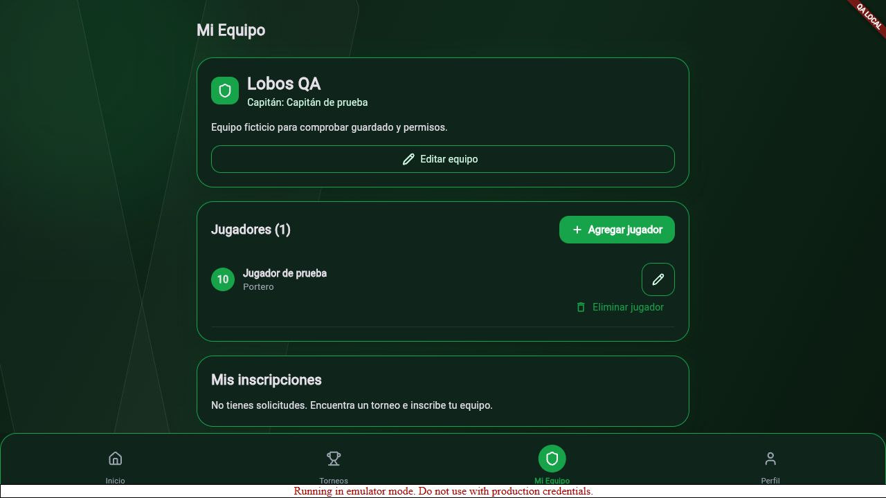
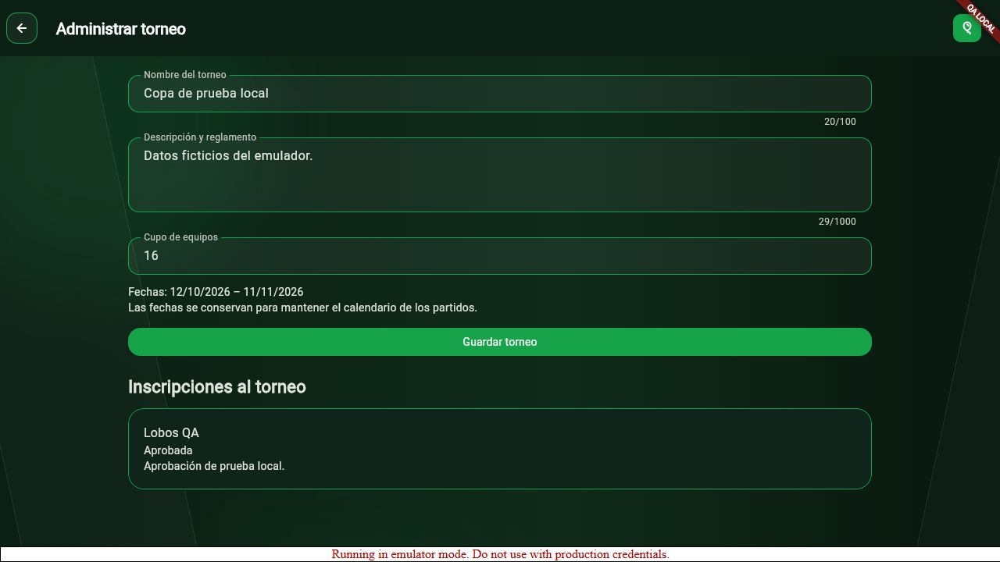

# Validación de login compartido, administrador y capitanes

Incremento de `feature/administrador`, basado en `chore/limpieza`.
Revisión del 13–14 de octubre de 2026. Esta evidencia distingue ejecución local
de configuración y funcionamiento con cuentas reales.

## Resultados ejecutados

| Control | Evidencia | Alcance |
| --- | --- | --- |
| Flutter, 13 de octubre | 66 pruebas pasaron, 0 fallaron | Login, formularios, roles, cambio directo de UID, privacidad, administración y capitán con dobles de repositorio |
| Flutter, 14 de octubre | 67 pruebas pasaron, 0 fallaron | Incluye bloqueo seguro ante fallo de inicialización del perfil y recuperación al reintentar |
| Análisis, 14 de octubre | `No issues found`, salida 0 | Revisión tras el ajuste de arranque del perfil |
| Detección acotada de secretos, 14 de octubre | 0 coincidencias | Patrones de claves privadas, tokens GitHub y refresh tokens en archivos de texto versionables; no certifica ausencia de todo secreto |
| Reglas Firestore, 13 de octubre | 45 pruebas pasaron, 0 fallaron; salida 0 | Emulador `demo-futschool-admin`: permisos, propiedad, suspensión, validación y transacciones |
| Análisis, 13 de octubre | `No issues found`, salida 0 | Código Flutter integrado |
| Compilación, 13 de octubre | Builds web release normal y QA completados, salida 0 | Compilación; no demuestra acceso a producción |
| Dependencias de herramientas, 13 de octubre | 12 entradas: 7 altas, 5 moderadas, 0 críticas | `npm audit` completo devuelve 1; no se considera auditoría limpia |
| Servidor local | HTTP 200 y título FutSchool en `127.0.0.1:5421` | Distribución web local, sin túnel externo |

Las alertas npm corresponden a herramientas Node de pruebas/operador; no están
en el paquete Flutter publicado. Deben revisarse antes de operación institucional.
La compilación advierte sobre una familia Cupertino no incluida y el renderizador
SVG ignora filtros; los desenfoques del diseño se reproducen con widgets nativos.
No se interpretan estas advertencias como una auditoría de accesibilidad completa.

## Recorrido ejecutado en el navegador contra emuladores

Se usaron exclusivamente cuentas y datos ficticios preparados por
`tests/firestore/preview-seed.cjs`, con las mismas clases de repositorio Firebase
que utiliza la aplicación normal.

1. Acceso de `captain.demo@example.test`: aparece el inicio del capitán.
2. Registro de **Lobos QA**: el inicio muestra el nombre guardado.
3. Alta de **Jugador de prueba**, dorsal **10**, posición **Portero**:
   la plantilla muestra un integrante.
4. Inscripción a **Copa de prueba local**: estado **Pendiente de revisión** y
   botón de solicitud deshabilitado para evitar duplicados.
5. Acceso de `admin.demo@example.test`: el administrador consulta el equipo y
   encuentra su solicitud, conservados entre sesiones.
6. Aprobación con comentario: aparece **Aprobada** y el torneo pasa de **0/16**
   a **1/16** participantes.

No se completó en ese recorrido manual la programación de partidos ni la vuelta
del capitán después de aprobar. Esas funciones tienen cobertura de widgets y
reglas; no se atribuye una prueba manual no ejecutada. Hubo fallos intermitentes
del arranque de autenticación en la vista QA release que cedieron al recargar;
la persistencia de sesión tras recargar QA necesita revisión adicional.

## Incidente real después del login

El propietario reportó la pantalla «No se pudo guardar el cambio» después de
autenticarse. Corresponde al arranque `ensureProfile`, no al formulario de acceso.
Se añadió consulta explícita al servidor antes de crear el perfil: uno existente
no necesita una transacción de escritura. La creación conserva comprobación
atómica y permisos. Se añadió manejo específico de permisos, tiempo de espera y
ausencia de correo, sin conceder acceso ni ocultar el fallo como éxito.

La consola Firebase no permitió verificar la configuración actual: mostró error
al cargar el estado de aceptación de condiciones. Firebase CLI no tiene cuentas
autorizadas. La última publicación confirmada corresponde a reglas de
administración, anteriores a las colecciones de capitanes. Activar las reglas
nuevas y repetir el acceso real sigue pendiente; no se afirma haber corregido la
causa del incidente real únicamente por mejorar el cliente.

## Pendientes externos

- Publicar y comprobar las reglas e índices de este incremento en `futschool-2ef84`.
- Comprobar la cuenta administradora verificada y asignar su claim por operador.
- Verificar acceso real de ambos roles, Google y correo de recuperación.
- Completar responsable universitario, aviso, conservación y procedimiento ARCO.
- Revisar alertas de herramientas, respaldos restaurables, monitoreo y App Check.
- Revisar el resultado del workflow remoto correspondiente al commit entregado.

El proyecto no se declara listo para producción. Las reglas niegan por defecto
operaciones no autorizadas; no se habilitó acceso general para evitar el error.
